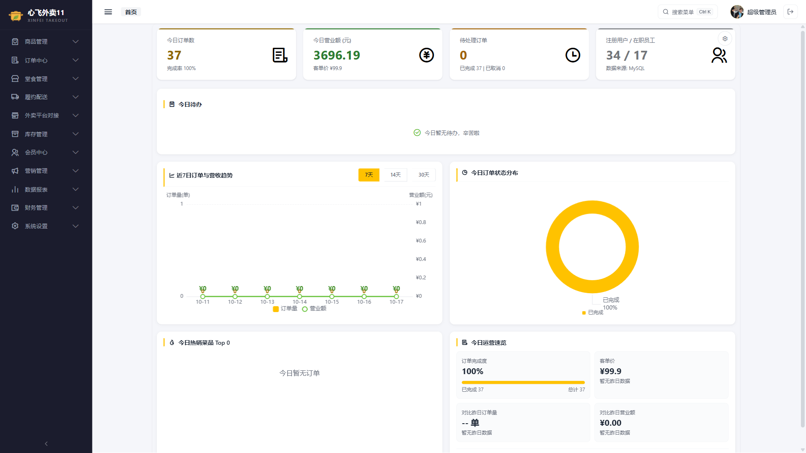
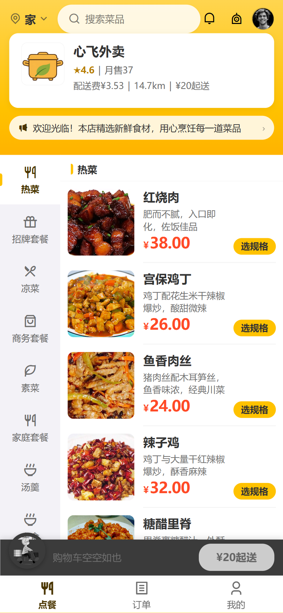

<div align="center">

# 心飞外卖 · Xinfei Takeout

### 覆盖堂食、外卖、进销存与配送的餐饮全栈管理系统，后端接了 AI 大模型

<b>管理后台、用户点餐 H5、骑手配送 H5，三个前端共用一套后端，打成一个 Jar 部署</b>

<br>


<br>


<br>


<br>


<br>


<br>


<br>
<br>

<a href="https://itxinfei.github.io/xinfei/"></a>
<a href="https://gitee.com/itxinfei/xfwm"></a>

</div>

<table align="center">
<tr>
<td align="center" width="100%">
<b>本项目以 Apache-2.0 协议开源，可以学习、做毕设、二次开发，也可以商用</b><br>
另提供二次开发、私有化部署、功能定制与项目讲解服务 &nbsp;|&nbsp;
QQ：<code>747011882</code> &nbsp;·&nbsp; 交流群：<code>661543188</code>
</td>
</tr>
</table>

---

## 一、项目介绍

**心飞外卖**是一套从实际餐饮门店的经营需求里做出来的全栈管理系统，基于 **Spring Boot + Vue 单体架构**。同一套实例、一个 Jar，同时承载管理后台、用户点餐和骑手配送三个前端，业务覆盖堂食、外卖、进销存、会员营销、多渠道支付、票据打印和经营报表。

- **管理后台**：Vue 3 + Element Plus，70 个页面，员工日常经营的主要操作都在这里
- **用户点餐 H5**：Vue 3 + Vant 4，26 个页面，扫码点餐、外卖到家、会员中心
- **骑手配送 H5**：Vue 3 + Vant 4，8 个页面，抢单派单与 GPS 实时追踪

三个前端都是免构建的原生 JS 静态资源，由 Spring Boot 直接伺服，改完刷新就生效。

数据层用 **MyBatis-Plus 行级租户插件**自动注入 `tenant_id`，拿不到租户上下文时直接拒绝查询，不降级放行。一套系统可以服务多个品牌和多门店，各自的数据不会串到一起。另外预留了美团、京东、饿了么、抖音四个外卖平台的对接骨架（工厂 + 适配器，默认关闭），协议层按各平台官方文档补即可。

> ### 规模
>
> **41 个模块（40 业务 + 1 演示）· 136 张数据表 · 1160 个 @Test · 954 个 Java 文件**。多租户隔离、资金安全、库存成本、履约配送、并发下单、幂等退款这些容易出问题的地方，都是按真实业务的路径实现的。克隆下来建好库就能跑，步骤见「快速开始」。

### 内容导航

[项目介绍](#一项目介绍) · [核心优势](#二核心优势) · [界面预览](#三界面预览) · [功能清单](#四功能清单) · [技术栈](#六技术栈) · [快速开始](#七快速开始) · [AI 配置](#八ai-配置) · [测试](#九测试) · [项目结构](#十项目结构) · [延伸文档](#十一延伸文档) · [常见问题](#十二常见问题) · [商业服务与联系](#十三商业服务与联系)

---

## 二、核心优势

<table>
<tr>
<td width="50%">

### AI 能力

接了 DeepSeek、通义千问、OpenAI、智谱 GLM 等几家大模型，用 SSE 做流式输出，落在智能点餐推荐、菜品文案生成、经营分析和多轮对话、用户画像几个场景上。多家供应商之间可以故障转移，后台也能热切换；首个 Token 超时会熔断，没配任何供应商时自动走 Mock。

### 多租户

MyBatis-Plus 行级租户插件自动注入 `tenant_id`，租户信息存在 `ThreadLocal` 里，取不到就拒绝查询。一套系统服务多个商家或品牌，可以直接按 SaaS 方式交付。

### 骑手配送

配送不依赖第三方平台。骑手可以抢单，店长可以手动派单，接单、取餐、送达的状态都能流转；骑手位置走 GPS 实时上报，配送费按围栏和距离分档，完成后自动入账。

</td>
<td width="50%">

### 资金链路

微信支付 V3、支付宝、货到付款三条通道，支付回调走状态机；退款做了幂等，全退会自动回补库存，也支持部分退款。收银日结、线下收款凭证、商家提现和发票管理都记在同一套账上，这条链路上的问题在实际使用中已经修过一轮。

### 进销存

原料档案支持 BOM 配方，供应商、采购入库、盘点、库存流水和成本核算串成一条链。菜品卖出去按配方自动扣原料，退款再补回来。经营报表和财务利润分析读的是同一套库存成本数据。

### 安全与质量

行级租户隔离、CSRF Token、Redis 滑动窗口限流、BCrypt 密码（兼容历史 MD5 并在登录时升级）、`#{}` 预编译、XSS 转义、日志脱敏、Jasypt 配置加密。限流在 Redis 挂掉时降级到本地内存，仍然拒绝而不是放行。**1160 个 @Test 和 JaCoCo 覆盖率报告**，改完跑一遍就知道有没有碰坏东西。

</td>
</tr>
</table>

---

## 三、界面预览

### 管理后台

<p align="center">
  
  <br><sub>工作台：今日订单、营业额、待办、近 7 日趋势、热销菜品、状态分布</sub>
</p>

<table align="center">
  <tr>
    <td align="center" width="25%"><br><sub>登录页</sub></td>
    <td align="center" width="25%"><br><sub>订单管理</sub></td>
    <td align="center" width="25%"><br><sub>菜品管理</sub></td>
    <td align="center" width="25%"><br><sub>套餐管理</sub></td>
  </tr>
  <tr>
    <td align="center" width="25%"><br><sub>分类管理</sub></td>
    <td align="center" width="25%"><br><sub>员工管理</sub></td>
    <td align="center" width="25%"><br><sub>桌台管理</sub></td>
    <td align="center" width="25%"><br><sub>收银台</sub></td>
  </tr>
  <tr>
    <td align="center" width="25%"><br><sub>采购入库</sub></td>
    <td align="center" width="25%"><br><sub>经营报表</sub></td>
    <td align="center" width="25%"><br><sub>AI 助手</sub></td>
    <td align="center" width="25%"><br><sub>营销活动</sub></td>
  </tr>
  <tr>
    <td align="center" width="25%"><br><sub>评价管理</sub></td>
    <td align="center" width="25%"><br><sub>角色权限</sub></td>
    <td align="center" width="25%"><br><sub>支付配置</sub></td>
    <td align="center" width="25%"><sub>后台共 <b>70</b> 个页面<br>（此处为代表页面）</sub></td>
  </tr>
</table>

### 用户点餐 H5

<table align="center">
  <tr>
    <td align="center" width="25%"><br><sub>首页</sub></td>
    <td align="center" width="25%"><br><sub>点餐</sub></td>
    <td align="center" width="25%"><br><sub>订单</sub></td>
    <td align="center" width="25%"><br><sub>会员中心</sub></td>
  </tr>
  <tr>
    <td align="center" width="25%"><br><sub>AI 助手</sub></td>
    <td align="center" width="25%"><br><sub>个人中心</sub></td>
    <td align="center" width="25%"><br><sub>扫码点餐</sub></td>
    <td align="center" width="25%"><br><sub>消息中心</sub></td>
  </tr>
</table>

### 骑手配送 H5

<table align="center">
  <tr>
    <td align="center" width="25%"><br><sub>接单大厅</sub></td>
    <td align="center" width="25%"><br><sub>我的任务</sub></td>
    <td align="center" width="25%"><br><sub>任务详情</sub></td>
    <td align="center" width="25%"><br><sub>骑手登录</sub></td>
  </tr>
</table>

---

## 四、功能清单

| 分类 | 功能模块 |
|------|------|
| 交易主链路 | 菜品分类、菜品管理（多口味、多规格、图片、BOM 配方）、套餐组合、购物车、收货地址、下单、订单状态机、订单备注、催单、用户评价、再来一单 |
| 履约配送 | 配送围栏校验、阶梯 / 按距离配送费、自有骑手体系（抢单大厅、店长派单、GPS 实时追踪）、到店堂食、桌台开台、后厨出餐大屏 KDS、收银 / 后厨小票打印、自提核销 |
| 收银支付 | 微信支付 V3、支付宝、货到付款、多渠道后台配置、支付回调对账、全额 / 部分退款（幂等）、收银台、收银日结、线下收款凭证上传、发票抬头 / 开票记录、商家提现 |
| 进销存成本 | 原料档案、供应商管理、采购入库、库存盘点、库存流水台账、菜品 BOM 自动扣料、成本核算、退款自动回补库存 |
| 会员营销 | 会员等级、积分、余额储值、优惠券（满减 / 折扣 / 无门槛）、秒杀、满减、买赠、新客立减、拼团团购、推荐有礼、用户收藏、用户画像 |
| 经营管理 | 数据工作台、经营报表（营业额 / 订单 / 客单价 / 热销）、财务利润分析、多门店管理、员工考勤、排班、催单超时预警、Excel / PDF 数据导出 |
| 平台与系统 | AI 智能引擎、多平台外卖对接骨架（美团 / 京东 / 饿了么 / 抖音）、消息通知（短信 / 站内 / SSE 推送）、RBAC 角色权限、操作日志审计、定时任务调度、行政区域、数据字典 |

### 安全防护

Session + HttpOnly Cookie 鉴权（HttpSession 落 Redis，多副本共享登录态）· MyBatis-Plus 行级租户隔离（上下文缺失 fail-closed）· CSRF Token · Redis 滑动窗口限流 `@RateLimit`（Redis 故障自动降级本地内存，仍拒绝放行）· 全部 SQL 走 `#{}` 预编译防注入 · XSS 输出转义 · 安全响应头 · BCrypt 密码加密（兼容历史 MD5 并在登录时自动升级）· 登录 / 关键操作日志审计 · 日志敏感信息脱敏 · 配置项 Jasypt `ENC()` 加密。

---

## 五、适用人群

| 你是… | 心飞能给你 |
|---|---|
| 计算机专业学生 | 三端、AI、多租户、真实支付都在一个项目里，适合拿来读源码、做毕业设计，也能写进简历 |
| 餐饮商家 / 创业者 | 自己部署，数据留在自己机器上，一套系统管门店，不用按年买 SaaS |
| 全栈开发者 | 分层、多租户、支付和 1160 个 @Test 都在，可以直接二开，也可以拆出来当脚手架 |
| 外包 / 技术团队 | Apache-2.0 允许商用交付，起步阶段不必从零搭架子 |

---

## 六、技术栈

### 后端技术

| 分类 | 技术选型 |
|---|---|
| 核心框架 | JDK 25 · Spring Boot 4.1.1 · Spring Framework 7 · Spring MVC · Spring AOP（AspectJ）· Jakarta EE 11 |
| 持久层 | MyBatis-Plus 3.5.17（spring-boot4-starter + jsqlparser）· MySQL Connector/J 9.7.0 · HikariCP 7.0.2 连接池 |
| 缓存 & 锁 | Redis · Spring Data Redis · Spring Session Redis（HttpSession 落 Redis，多副本共享登录态）· Commons Pool2 · 分布式锁 · 滑动窗口限流 |
| 数据迁移 | Flyway 12.4.0（spring-boot-flyway + flyway-mysql） |
| 业务工具 | Hutool 5.8.48 · Commons Lang3 · Commons Text 1.15.0 · Lombok 1.18.48 · Bean Validation |
| 支付集成 | 微信支付 V3（wechatpay-java 0.2.17）· 支付宝 SDK 4.40.1044.ALL · 货到付款 |
| 消息 & 实时 | 阿里云短信 SDK 4.7.10 · SSE（SseEmitter）· WebSocket · Spring 异步线程池 |
| 文档 & 导出 | SpringDoc OpenAPI 3.1.1 · Apache POI 5.5.1（Excel）· iText 5.5.13.6 + 亚洲字体 5.2.0（PDF）· ZXing 3.5.4（二维码） |
| 序列化 | Jackson 3（`tools.jackson`，全量替换 Jackson 2） |
| 安全 & 运维 | Jasypt 4.0.4 配置加密 · Spring Security Crypto · Actuator 监控 · 全局异常处理 · 链路追踪 TraceId |

### 前端技术

| 端 | 技术选型 |
|---|---|
| 管理后台 | Vue 3.5.44 · Element Plus 2.14.7 · Axios · ECharts 5 · 原生 JS（免构建） |
| 用户点餐 H5 | Vue 3.5.44 · Vant 4.10.2 · Remix Icon · Axios · 原生 JS（免构建） |
| 骑手配送 H5 | Vue 3.5.44 · Vant 4.10.2 · Remix Icon · GPS 定位 · Axios |
| 设计体系 | 三端共享样式令牌（Design Tokens）· 统一的 `crud-table` / `crud-dialog` 组件规范 |

### AI & 测试

| 分类 | 技术选型 |
|---|---|
| AI 引擎 | DeepSeek · 通义千问 Qwen · OpenAI · 智谱 GLM；适配器 + 工厂模式，多供应商故障转移，后台热切换 |
| 测试框架 | JUnit 5 · Mockito 5.23 · Spring Boot Test · MockMvc · 真实 MySQL + Redis 集成测试 |
| 质量度量 | JaCoCo 0.8.13 覆盖率 · maven-surefire 3.5.6（复用 JVM，JaCoCo agent 只加载一次） |

---

## 七、快速开始

### 环境要求

| 依赖 | 版本 |
|---|---|
| JDK | **25**（pom 里 `java.version=25`，编译走 `release=25`；构建前确认 `JAVA_HOME` 指向 JDK 25，用 21 及以下会直接编译失败） |
| MySQL | 8.0 |
| Redis | 7（Docker 镜像 `redis:7-alpine`） |
| Maven | 3.9+（Boot 4 最低 3.6.3，实测 3.9.16） |

> 三端前端都是免构建的静态资源（Vue 3 全局引入 + 浏览器原生 JS），跑起来不需要 Node.js。只有执行 UI 规范 pre-commit 门禁（`scripts/lint-ui-conventions.js`）时才要装 Node。Playwright E2E 套件放在本地 `tests/` 目录，按 `.gitignore` 不随仓库发布。

> 参与贡献的话，建议执行一次 `bash hooks/install.sh` 装上 UI 规范 pre-commit 门禁：ERROR 级别的违规会阻断提交，规则和豁免清单在 `scripts/lint-ui-conventions.js` 头部。

### 启动步骤

```bash
# 1. 克隆项目
git clone https://gitee.com/itxinfei/xfwm.git
cd xinfei

# 2. 创建数据库（务必指定 utf8mb4，否则中文数据乱码）
mysql -uroot -p -e "CREATE DATABASE IF NOT EXISTS xinfei CHARACTER SET utf8mb4;"

# 3. 启动：dev 环境由 Flyway 自动建表 + 写入最小种子（V1 全量表结构 129 张表、
#    V2 租户/门店/超管账号，V3 起为增量迁移，目前到 V17），首次启动即可完成初始化
mvn spring-boot:run
```

> **迁移机制**：结构脚本在 `src/main/resources/db/migration/`，`V1`=全量表结构基线（129 张表）、`V2`=最小可登录数据，新变更从 `V3` 起递增，当前最新是 `V17`；加上后续迁移新增的 7 张表，全库共 136 张。约定、既有结构漂移清单见 `docs/FLYWAY_MIGRATION.md`。
> 已有库（例如从全量演示库 `db/xinfei.sql` 恢复的库）首次启动只会记一条 version=2 的基线行，**不会重放 V1/V2、不会覆盖你已有的数据**。
>
> 也可以走旧的手工建表路径（`src/test/resources/schema*.sql` + `db/seed-minimal.sql`，`CREATE TABLE IF NOT EXISTS` 可重复执行）：先手工建完表再启动，Flyway 同样只记基线。这套夹具 2026-10-16 起已与 V1 基线结构核验一致（129 张表，列、索引、排序规则零漂移），两条路径任选；核验方法见 `docs/FLYWAY_MIGRATION.md` 第 7 节。
>
> 想要带演示数据的完整环境：含全部表结构和各端演示数据的全量建库脚本没随仓库发布（体积大，也含本地定制），需要的话走文末 QQ 747011882 或交流群。导入空库后启动，应用只会记基线。

启动后访问：

| 应用 | 地址 | 默认账号 |
|---|---|---|
| 管理后台 | http://localhost:8080/backend/index.html | `admin` / `123456` |
| 用户点餐 | http://localhost:8080/front/index.html | 手机号验证码登录（新号自动注册，dev 模式验证码见日志） |
| 骑手端 | http://localhost:8080/rider/login.html | 自建库没有骑手数据，需管理员先在后台创建骑手 |
| 接口文档 | http://localhost:8080/swagger-ui.html | — |

> **首次登录后请立即修改默认密码。**

### Docker 一键部署（免装 JDK/MySQL/Redis）

适合自用服务器，或者小店收银机旁的主机（需已安装 Docker，含 compose 插件）：

```bash
cp .env.example .env        # 按需改：数据库密码 / 端口 / 对外访问地址（手机扫码填局域网 IP）
bash docker/up.sh   # 构建镜像 + 拉起 MySQL 8 / Redis 7 / 应用 + 自动建库
```

- 首启 `docker/db-init.sh` 只确保 `xinfei` 库存在；建 136 张表 + 最小种子数据（`admin`/`123456`）由应用启动期的 Flyway 完成（`FLYWAY_ENABLED` 默认 true，见 `.env.example`）。已有库只记一条基线行，不重放、不动业务数据。
- 默认 `prod` profile，短信和支付 mock 开着（验证码只打日志、下单走模拟支付）。接真实微信/支付宝后通过环境变量关掉。
- 数据持久化：`mysql-data` / `redis-data` / `app-uploads` 三个 Docker 卷；上传的图片在 `app-uploads`。
- 日常运维：

```bash
bash docker/backup.sh                                     # 备份全库到 backups/
bash docker/restore.sh backups/xinfei-xxx.sql.gz          # 恢复（会覆盖现有数据，有确认）
docker compose logs -f app                                        # 看日志
docker compose down                                               # 停止（保留数据卷）
```

<details>
<summary><b>前端改完不生效？</b></summary>

`spring-boot:run` 从 `target/classes` 伺服静态资源，改完 HTML/JS/CSS 后需要同步一次，再硬刷新（`Ctrl + Shift + R`）：

```bash
mvn process-resources
```

</details>

### 生产部署

```bash
mvn clean package -DskipTests
java -jar target/xinfei_takeout-1.0-SNAPSHOT.jar --spring.profiles.active=prod
```

生产参数走 `application-prod.yml`（环境变量注入，敏感值支持 Jasypt `ENC(...)` 加密）。

---

## 八、AI 配置

- **零配置也能跑**：不配任何 AI 供应商时，AI 能力自动走 Mock 模式，系统照常运行。
- **接真实模型（推荐）**：在后台「AI 供应商管理」里填供应商和 API Key（存于 `ai_provider_config` 表）。多家供应商之间可以故障转移，切换不用重启。
- 支持 DeepSeek、通义千问（Qwen）、OpenAI、智谱 GLM 等；能力覆盖智能点餐推荐、菜品文案、经营分析、多轮对话与用户画像。
- 短信、推送同样默认 `mock-mode=true`（只打印日志不真发），接真实通道见 `application.yml` 配置项。

---

## 九、测试

> **测试与开发共用本地 `xinfei` 单库**，靠「租户 + 命名空间」隔离：演示数据挂租户 1，自动化测试数据挂租户 999（高 ID 防冲突）。
> **红线：严禁把测试指向公网 / 生产库。** 测试清理（`TestDatabaseCleaner` 与 `@Sql`）只会删除**租户 999 的数据或 `test:` 命名空间**，不影响租户 1 演示数据；新增测试的显式主键请选用 **990000+ 高位段**（`TestIdGuard` 会在撞库时 fail-fast）。

```bash
# 全量测试（需先启动本地 MySQL + Redis）
mvn test

# 编译校验（改完 Java 必做）
mvn clean compile
```

后端有 **157 个可执行测试类（另有 1 个抽象基类 `BaseControllerTest`）、1160 个 `@Test` 方法**，包括单元测试、Spring 集成测试和并发负载测试，JaCoCo 产出覆盖率报告。Surefire 复用 JVM 并把堆固定在 4096m，避免多次 fork 时 JaCoCo agent 和 Spring 上下文叠加导致的崩溃。

---

## 十、项目结构

```
xinfei/
├── src/main/java/com/xinfei/
│   ├── XinfeiApplication.java     # 启动类
│   ├── common/                    # 公共组件
│   │   ├── R.java                 #   统一响应结构
│   │   ├── BaseContext.java       #   ThreadLocal 用户/租户上下文
│   │   ├── GlobalExceptionHandler.java   # 全局异常处理
│   │   ├── RateLimit(+Aspect).java       # Redis 滑动窗口限流
│   │   ├── MyMetaObjectHandler.java      # 自动填充 createTime/updateUser
│   │   ├── PasswordUtils / CsrfTokenUtil / LogMaskUtils
│   │   ├── annotation/            #   自定义注解
│   │   ├── aspect/ event/ validation/ utils/
│   ├── config/                    # 配置类（WebMvc / MyBatis / Redis / Session Redis / Jackson /
│   │   │                          #   OpenAPI / CORS / 异步 / 调度 / 过滤器注册 / Jasypt / WebSocket）
│   ├── filter/                    # 过滤器（登录校验、安全头、链路追踪）
│   ├── dto/  enums/  utils/
│   └── module/                    # 41 个业务模块，各含 controller/service/mapper/model/dto
│       │
│       ├── 【交易主链路】
│       │   ├── order/             #   订单（状态机）
│       │   ├── dish/              #   菜品（口味/规格/BOM）
│       │   ├── setmeal/           #   套餐
│       │   ├── category/          #   分类
│       │   ├── shopping/          #   购物车
│       │   ├── address/           #   收货地址
│       │   ├── payment/           #   支付渠道与回调
│       │   └── groupbuy/          #   拼团团购
│       │
│       ├── 【履约配送】
│       │   ├── delivery/          #   骑手配送（抢单/派单/GPS）
│       │   ├── platform/          #   第三方外卖平台适配
│       │   ├── dining/            #   堂食桌台
│       │   ├── printer/           #   小票打印引擎
│       │   └── kds/               #   后厨出餐大屏
│       │
│       ├── 【经营管理】
│       │   ├── store/             #   门店
│       │   ├── dashboard/         #   工作台
│       │   ├── report/            #   经营报表
│       │   ├── cost/              #   成本核算
│       │   ├── finance/           #   财务利润
│       │   ├── withdraw/          #   商家提现
│       │   ├── cashier/           #   收银台/日结
│       │   ├── attendance/        #   考勤
│       │   ├── schedule/          #   排班
│       │   └── urgency/           #   催单预警
│       │
│       ├── 【会员营销】
│       │   ├── member/            #   会员等级/积分/余额
│       │   ├── user/              #   C 端用户
│       │   ├── customer/          #   客户/画像
│       │   ├── marketing/         #   优惠券/秒杀/满减/买赠
│       │   ├── recommend/         #   推荐有礼
│       │   ├── notification/      #   短信/站内/SSE 消息
│       │   ├── invoice/           #   发票
│       │   ├── favorite/          #   用户收藏
│       │   └── subsidy/           #   企业餐补
│       │
│       └── 【平台与系统】
│           ├── ai/                #   AI 引擎（多模型适配/故障转移）
│           ├── auth/              #   认证授权
│           ├── sys/               #   系统/字典
│           ├── tenant/            #   租户管理
│           ├── region/            #   行政区域
│           ├── common/            #   模块公共能力
│           ├── export/            #   Excel/PDF 导出
│           ├── inventory/         #   进销存（原料/供应商/采购/盘点）
│           └── concurrency/       #   JDK 25 特性演示（非业务，端点 /demo/threads/**）
│
├── src/main/resources/
│   ├── backend/                   # 管理后台（Element Plus，70 页，api/page/js/styles）
│   ├── front/                     # 用户点餐 H5（Vant 4，26 页）
│   ├── rider/                     # 骑手配送 H5（Vant 4，8 页）
│   ├── shared/                    # 三端共享（CSRF 核心、状态字典、样式令牌）
│   ├── scripts/rate_limit.lua     # Redis 限流 Lua 脚本
│   └── application.yml / application-dev.yml / application-prod.yml
│
├── src/main/resources/db/migration/   # Flyway 迁移脚本（V1 全量表结构基线 / V2 最小种子 / V3~V17 增量）
│
├── src/test/                      # JUnit 5 测试（157 个可执行测试类 / 1160 个 @Test）
│   └── resources/schema*.sql      # 测试建表夹具（@Sql 使用；结构以 src/main/resources/db/migration/ 为准）
│
├── db/
│   └── seed-minimal.sql           # 最小初始化数据（旧手工路径留档；Flyway 路径已并入 V2）
├── docs/                          # 架构 / 数据模型 / 模块 API 文档 + screenshots/
├── scripts/                       # 仅发布 lint-ui-conventions.js（UI 规范门禁）；其余本地工具脚本不入库
└── pom.xml
```

---

## 十一、延伸文档

| 文档 | 说明 |
|---|---|
| [项目总览](docs/项目总览.md) | 业务背景与整体设计 |
| [模块与接口](docs/模块与接口.md) | 各模块接口清单 |
| [数据模型](docs/数据模型.md) | 136 张数据表与关系设计 |
| [架构设计](docs/架构设计.md) | 关键技术选型与决策记录 |
| [后台页面清单](docs/后台页面清单.md) | 管理后台全部页面索引 |

> 仓库还带了一个自研文档站（零依赖的 GFM 渲染器），本地启动后可以浏览模块接口和通用文档。

---

## 十二、常见问题

<details>
<summary><b>导入 SQL 时中文乱码 / 建表报错？</b></summary>

1. 漏了 `--default-character-set=utf8mb4`（最常见）——不指定时 MySQL 客户端会按 GBK 解释脚本；
2. 建库没指定字符集：`CREATE DATABASE xinfei CHARACTER SET utf8mb4;`（已有库可 `ALTER DATABASE xinfei CHARACTER SET utf8mb4;`）；
3. 走 Flyway 路径（推荐）不会乱码：`spring.flyway.encoding=UTF-8` 已固定；如需重来，`DROP DATABASE xinfei;` 后重建即可，下次启动自动重放 V1/V2；
4. 手工导 `schema*.sql` 可重复执行，报「表已存在」属正常。
</details>

<details>
<summary><b>建完表登录不了 / 提示用户名或密码错误？</b></summary>

走 Flyway 路径不会有这个问题：V2 会写入租户、门店和 `admin`（口令 123456）。只有手工只导了 `schema*.sql` 而没导 `db/seed-minimal.sql` 时，`employee` 表才为空。
</details>

<details>
<summary><b>如何重置管理员密码？</b></summary>

密码统一用 BCrypt（强度 10）加密，兼容历史 MD5 并在登录时自动升级。忘记密码时可以直接改库（`password_type` 填 `BCRYPT`）：

```sql
UPDATE employee SET password = '<BCrypt哈希>', password_type = 'BCRYPT' WHERE username = 'admin';
```

已登录时也可以通过接口修改（需要旧密码，新密码至少 6 位）：

```bash
curl -c c.txt -X POST http://localhost:8080/employee/login \
  -H "Content-Type: application/json" -d '{"username":"admin","password":"原密码"}'
curl -b c.txt -X PUT http://localhost:8080/employee/password \
  -H "Content-Type: application/json" -d '{"oldPassword":"原密码","newPassword":"新密码"}'
```
</details>

<details>
<summary><b>AI 助手不工作 / 答得不对？</b></summary>

1. 未配置供应商时走 Mock 模式，返回的是占位内容，属于预期；
2. 已配置的话，检查后台「AI 供应商管理」里供应商是否启用、API Key 是否有效且有余额；
3. 看应用日志里的 AI 调用错误。短信、推送同样默认 `mock-mode=true`，需要真发要到 `application.yml` 里显式配置。
</details>

<details>
<summary><b>平台外卖定时任务报 UnknownHostException？</b></summary>

多平台对接目前只是占位骨架，默认受 `xinfei.platform.sync-enabled=false` 控制，不往外发请求。出现这个日志说明开关被打开了；没按官方文档实现协议层之前，保持 `false` 就行。
</details>

<details>
<summary><b>接口报「表不存在」？</b></summary>

结构以 Flyway 为准：新增表或列写 `src/main/resources/db/migration/V<n>__描述.sql`（dev 启动自动执行，prod 需人工注入 `FLYWAY_ENABLED=true`），并同步 `src/test/resources/schema*.sql` 供测试夹具使用。接口报「表不存在」，先查 `flyway_schema_history` 是否缺这个版本，再确认测试夹具有没有同步。
</details>

<details>
<summary><b>mvn 编译报 JDK 版本相关错误？</b></summary>

项目要求 JDK 25（pom 里 `java.version=25`，编译走 maven-compiler-plugin 的 `release`）。如果本机 PATH 上的 `java` 是旧版本、`JAVA_HOME` 又为空，会报 `release version 25 not supported` 或 `invalid target release: 25`。把 `JAVA_HOME` 指向 JDK 25 再构建：

```bash
export JAVA_HOME=/path/to/jdk-25                    # Windows: set JAVA_HOME=D:\Program Files\Java\jdk-25
mvn clean compile
```
</details>

<details>
<summary><b>接口莫名 429 / Redis 报错？</b></summary>

限流基于 Redis 滑动窗口。Redis 不可用时会降级成本地内存滑动窗口（fail-closed，不会直接放行），日志里会有告警；Redis 恢复后自愈。开发期可以在 `application-dev.yml` 里调低对应接口的限流阈值。
</details>

---

## 十三、商业服务与联系

<div align="center">

<table>
<tr>
<td align="center" width="50%">

### 付费技术服务

本项目以 Apache-2.0 协议开源，可以免费使用。作者另外提供付费的技术支持：

- 二次开发与功能定制（对接平台、新增业务、UI 调整）
- 私有化部署交付（服务器、域名、支付商户配置）
- 项目讲解与毕设答疑（架构、源码、面试考点）
- 全量建库脚本和演示数据
- 日常技术答疑与长期维护

<b>商务联系 QQ：<code>747011882</code></b>

</td>
<td align="center" width="50%">

### 加入社区


<sub>扫码关注微信公众号「心飞为你飞」</sub>

<br>

仓库：[gitee.com/itxinfei/xfwm](https://gitee.com/itxinfei/xfwm)<br>
官网：[itxinfei.github.io/xinfei](https://itxinfei.github.io/xinfei/)<br>
QQ 交流群：**[661543188](https://qm.qq.com/cgi-bin/qm/qr?k=gNgch-wCkfUu-QbI7DZSudrax2BN7vY0)**

</td>
</tr>
</table>

<br>

### 如果这个项目对你有帮助，欢迎点个 Star

<a href="https://gitee.com/itxinfei/xfwm"></a>

</div>